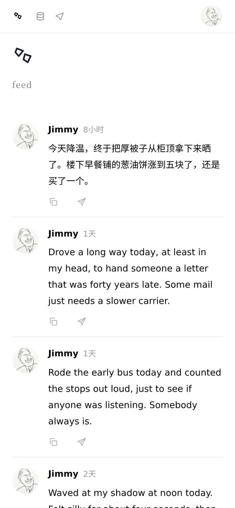
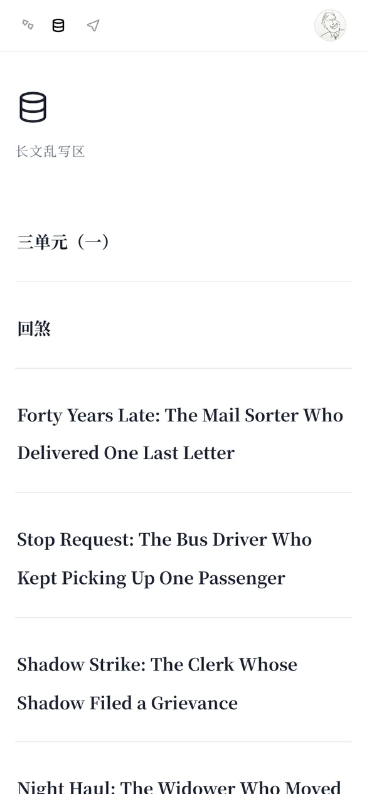
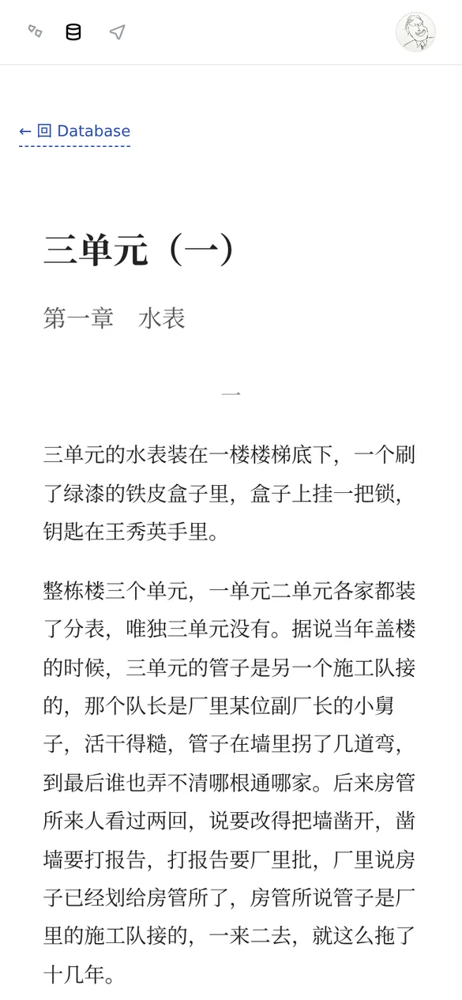
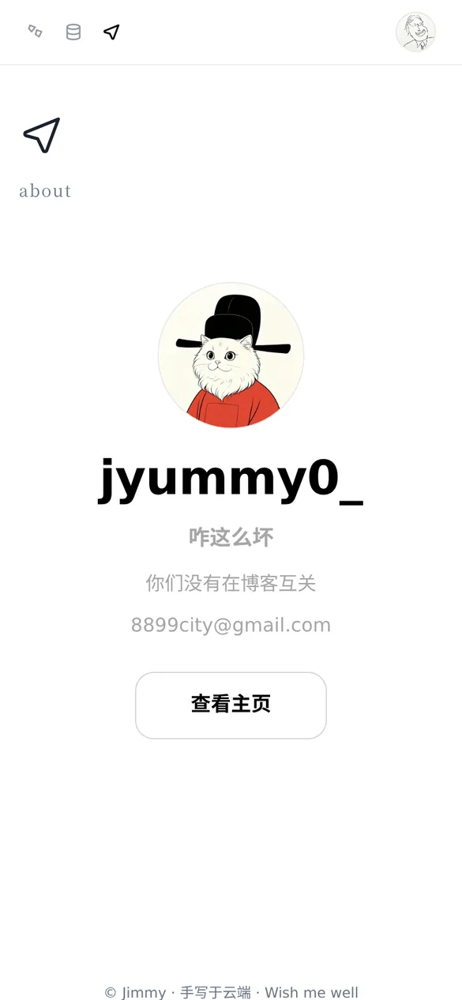
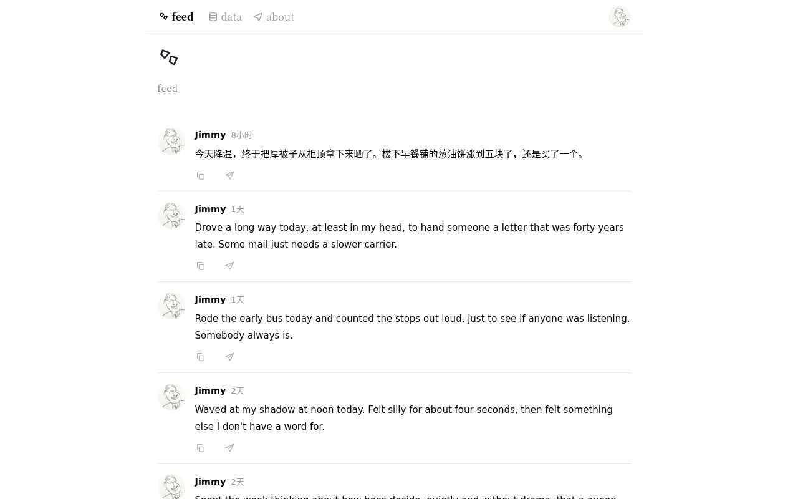

# Jim Blog

一个用 Vue 3 + Vite 写的个人博客。前端页面和接口都跑在**同一个 Cloudflare Worker** 里，直接读 D1 数据库和 R2 图片桶，没有反代、没有额外服务器。

[](https://deploy.workers.cloudflare.com/?url=https://github.com/gguioo/jimmy-blog)

点上面的按钮即可部署到你自己的 Cloudflare 账号（见第四节）。

## 截图

| feed | data | 阅读页 |
| :---: | :---: | :---: |
|  |  |  |

| about | 点开头像 |
| :---: | :---: |
|  |  |

电脑端：



---

## 一、怎么用（页面说明）

顶部导航从左到右是 `feed`、`data`、`about`，最右边是一个圆形头像。点文字就切换页面，当前页面的文字会高亮。

| 导航 | 地址 | 内容 |
| --- | --- | --- |
| `feed` | `/` | 碎片流：一条条短文字 + 图片，最新的在最上面。点任意一张图会全屏打开，左右滑动（电脑上用方向键）切换同一条里的其他图，点空白处或手机返回手势关闭 |
| `data` | `/database` | 长文列表：标题 + 日期。点一篇进入阅读页 `/post/:id` |
| 阅读页 | `/post/:id` | 文章的原始 HTML 原样显示在博客页面里面（放在 Shadow DOM 中，文章自带的样式不会影响博客，博客的样式也不会改动文章）。顶部导航保留，左上角有「← 回 Database」，手机返回手势也能回到列表 |
| `about` | `/about` | 个人卡片：头像、名字、一句简介、「查看主页」按钮（跳 GitHub） |

**右上角头像**：点一下，头像会从导航栏慢慢放大到屏幕中央，背景变暗；再点一下头像、点空白处，或者用手机返回手势，它会缩回原位。返回手势只会收起头像，不会离开网站。

其他细节：

- 打开未知地址会自动回到首页。
- 页面切换不会整页刷新（单页应用），刷新任何子页面也能正常打开。
- 文章里的 `<script>` 不会执行，只显示内容和样式。

---

## 二、怎么改成你自己的

### 头像

**最简单：在后台换。** 打开后台（博客地址加 `/admin`） →「头像」→ 选一张图，上传后导航栏头像和 feed 小头像一起换掉（about 大头像不受影响，始终用自己的默认图），刷新就生效，不用重新部署。头像存在 R2 `jy-blog-feed` 里，地址记在 D1 的 `settings` 表（`key='avatar'`），「清理死图」不会删它。

默认图如下（导航栏和 feed 在后台没设置头像时使用，about 一直使用自己的）。默认图都在 `jimmy-blog-vue/public/img/`，**直接用同名文件替换**然后重新构建部署即可：

| 文件 | 出现在哪 |
| --- | --- |
| `me-avatar.jpg` | 导航栏右上角的圆形头像，以及点开后放大的那张 |
| `jimmy-avatar.jpg` | feed 每条碎片左边的小头像 |
| `hanmoon-avatar.jpg` | about 页个人卡片的大头像 |
| `favicon.png` | 浏览器标签页图标 |

建议用正方形图片，500×500 左右就够；会被自动裁成圆形。想三处用同一张图，把三个文件都换成同一张即可。

换默认图：同名文件替换后推送到 GitHub，会自动重新部署（见第四节）。

### 名字、简介、主页链接

都在 `jimmy-blog-vue/src/views/AboutView.vue`：

- `pf-name`：显示的名字
- `pf-bio`：一句简介
- `查看主页` 按钮的 `href`：点了跳去哪里
- 页脚那行 `© Jim · …` 也在这个文件底部

### 导航文字

在 `jimmy-blog-vue/src/App.vue` 顶部的导航数组里改（`feed` / `data` / `about` 的文字和对应路径）。

---

## 三、内容从哪来、怎么发

博客本身**只读**，不带发布功能。内容存放在：

| Worker 绑定名 | 资源 | 存什么 |
| --- | --- | --- |
| `DB` | D1 数据库 `jy-blog` | 表 `feed`（碎片：`id, text, photos, created_at`）和表 `articles`（长文：`id, title, html, created_at`） |
| `FEED_IMG` | R2 桶 `jy-blog-feed` | 碎片里的图片，通过 `/f/<文件名>` 访问 |
| `ART_IMG` | R2 桶 `jy-blog-article` | 文章里的图片，通过 `/a/<文件名>` 访问 |

发碎片、发文章、删内容都在后台 `/admin` 里做；发完博客刷新就能看到。

博客提供的只读接口：

- `GET /api/feed`：全部碎片（含图片地址）
- `GET /api/posts`：长文列表
- `GET /api/posts/:id`：单篇长文 `{ slug, title, html, created_at }`
- `GET /api/profile`：后台设置的头像 `{ avatar }`，没设置时为 `null`

---

## 四、一键部署（Deploy to Cloudflare）

1. 点 README 顶部的 **Deploy to Cloudflare** 按钮，登录 Cloudflare 和 GitHub
2. Cloudflare 会把这个仓库复制一份到你的 GitHub，并自动创建：Worker、D1 数据库、两个 R2 桶（名字可以在页面上改）
3. 页面会要求填 `ADMIN_TOKEN`，这就是后台密码，自己设一个
4. 点部署。构建时会自动建好数据库表（`migrations/`），完成后给你一个 `*.workers.dev` 地址

之后改代码：直接推送到你那份仓库的 `main`（或在 GitHub 网页上改文件提交），Cloudflare 会自动重新构建部署，不需要任何 token 或 Actions。

想用自己的域名：Cloudflare 后台 → 这个 Worker → Settings → Domains & Routes → 添加自定义域名。绑定后 `https://你的域名/` 是博客，`https://你的域名/admin` 是后台，代码不用改。

## 后台

后台和博客在同一个 Worker 里：

- 页面：`/admin`
- 接口：`/admin/api/*`，需要 `Authorization: Bearer <ADMIN_TOKEN>`
- 代码：`worker/admin.js`、`worker/admin.html`
- 密钥 `ADMIN_TOKEN` 是 Worker 的 Secret，部署时填写，不在仓库里；以后可在 Worker → Settings → Variables and Secrets 里改

## 五、本地开发与手动部署

需要 Node 18+ 和一个 Cloudflare 账号。

```bash
npm ci
npm run build      # 打包前端，产物在 jimmy-blog-vue/dist
npm run deploy     # 建表 + 部署 Worker 和静态页面
```

手动部署时，把 `wrangler.jsonc` 里的 `name`、D1 的 `database_name` / `database_id`、两个 R2 桶名换成你自己的（用按钮部署会自动处理）。

## 目录结构

```
jimmy-blog-vue/      前端（Vue 3 + Vite + TypeScript）
  public/img/        头像、图标
  src/App.vue        导航栏、头像放大动画
  src/avatar.ts      头像：后台设置优先，没有就用默认图
  src/views/         HomeView(feed) / DatabaseView(data) / PostView(阅读页) / AboutView
worker/worker.js     Worker：静态页面 + /api 只读接口 + R2 图片，/admin 转给后台
worker/admin.*       后台页面和接口
migrations/          D1 建表语句
wrangler.jsonc       部署配置
```
